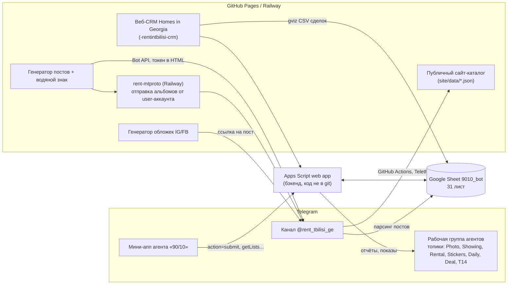
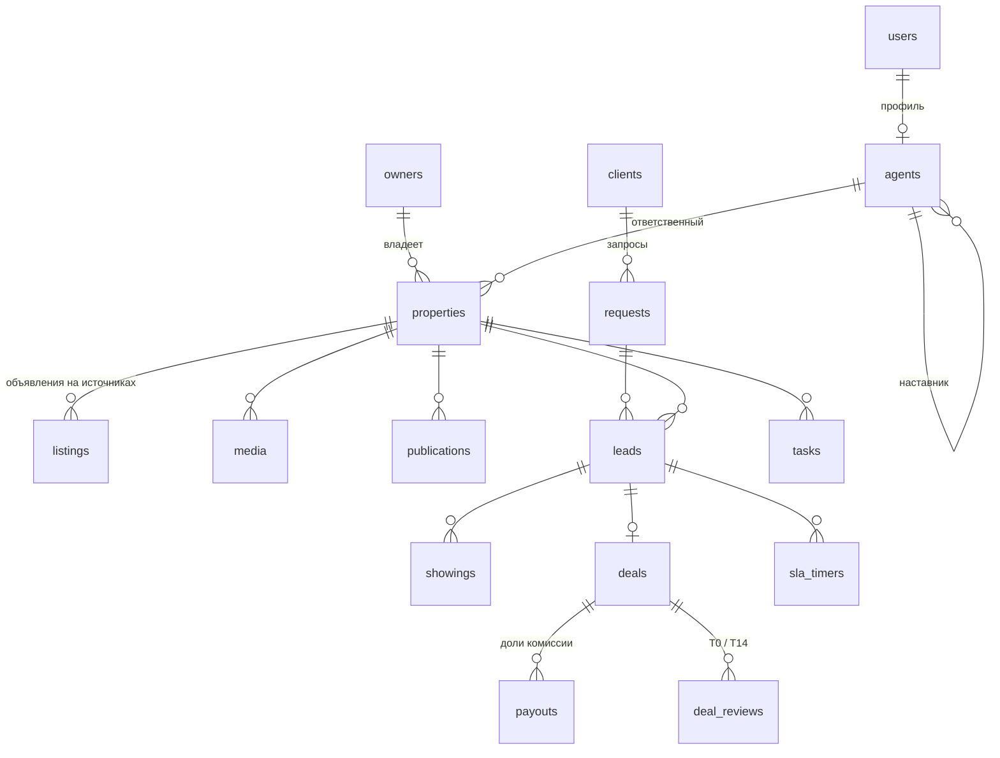

# Аудит текущей системы Rent in Tbilisi / Homes in Georgia

23.10.2026. Источники: Google-таблица `9010_bot` (31 лист) и 9 публичных репозиториев GitHub-организации
PlatformDGE. Всё смотрели только на чтение. Личных данных (телефоны, имена, Telegram id, контакты собственников)
в этом документе нет: только структура, типы, объёмы и статусы.

Связанные документы: [TZ-stage2-crm.md](TZ-stage2-crm.md) (наш черновик этапа 2), [schema.md](schema.md) (наша база).

---

## 0. Самое срочное (до любой разработки)

1. **Таблица `9010_bot` открыта всем по ссылке (доступ «Читатель: все, у кого есть ссылка»)**, а её id лежит
   в коде публичных репозиториев (7 файлов). Значит, любой может прочитать базу собственников (телефоны),
   контакты клиентов, даты рождения агентов и **пароли Platform Desk открытым текстом** (лист `Platform_Desk_Users`).
   Нужно: закрыть доступ по ссылке, сменить пароли Platform Desk.
2. **В публичных репозиториях лежат 2 разных токена Telegram-ботов** прямо в HTML (их видит любой браузер):
   - `-rentintbilisi-crm/post-generator-modern.html`, строка 802;
   - `rent-tbilisi/post-generator.html` и `rent-tbilisi/Post Generator · rent_in_tbilisi.html`, строка 791;
   - `rent_in_tbilisi_90-10/miniapp.html` (4157), `miniapp_3.html` (4097), `miniapp_test.html` (4097),
     `post-generation.html` (772), `post-generator.html` (772).
   Нужно: перевыпустить оба токена в @BotFather и убрать их из клиентского кода (а лучше из истории git).
3. Адрес веб-приложения Apps Script (бэкенд мини-аппа) тоже в публичном коде и в одной ячейке таблицы;
   если он принимает запросы без проверки Telegram `initData`, любой может писать в таблицу.
   Админ-права в CRM проверяются только в браузере (`index.html`, ~4401–4421).
4. **`rent-mtproto` на Railway без авторизации и с CORS `*`**: его адрес есть в публичном HTML, значит любой может
   отправлять сообщения от user-аккаунта агентства в любой чат. Закрыть или выключить.
5. Ещё в коде: статический ключ фото-сервера (`rent-tbilisi/Code.gs:42`), пароль админки прямо в HTML
   (`grishashvili/admin.html:1011`, копия в `rent_in_tbilisi_90-10/admin.html`). Бэкенд посуточной аренды
   (`daily_rent_bot`) отдаёт все данные без проверки.

---

## 1. Коротко: как устроено сейчас

Вся система держится на одной Google-таблице. Её читают и пишут: Apps Script (бэкенд, **кода в репозиториях нет**,
скорее всего привязан к таблице), мини-апп агентов «90/10», веб-CRM, генератор постов, Python-скрипты.
Telegram — главный рабочий инструмент: канал `@rent_tbilisi_ge`, рабочая группа агентов с топиками,
отчёты публикуются в топики сообщениями.



Цифры (из листа `Analytics_Cache`, пересчитывается сам): ~1 975 сделок с 01.2025 по 10.2026 (50–140 в месяц),
средняя комиссия ~321 $, активных объявлений в канале ~7 600, около 50 агентов и рекрутов.

---

## 2. Листы таблицы

«Строк» = примерно заполненных (не размер сетки). «Кто пишет»: GAS = Apps Script бэкенд (по смыслу, кода нет),
MA = мини-апп `rent_in_tbilisi_90-10` (копия в CRM `platform-90-10.html`).

### Объекты

| Лист | Назначение | Ключевые колонки | ~Строк | Кто пишет / читает | Проблемы |
|---|---|---|---|---|---|
| `Owner_Base` | база собственников | имя, телефон (`995 5xx…`, без `+`), адрес (текст), ссылка (myhome.ge ~70%, ss.ge ~25%) | ~4 200 (сетка 52 тыс.) | вручную / импорт | нет id, нет связи с объектом; ссылка заполнена только у ~1/4; телефоны в разных форматах; дубли не проверяются |
| `Photo_Queue` | заявки «сделать фото» (Make Photo From Platform) | timestamp, agent, address (часто ссылка myhome/ss вместо адреса), phone, owner, date (`дд.мм чч:мм`), message_id, raw, source (`miniapp` или `<chat>_<topic>`) | ~1 100 | MA → GAS → топик Photo | `#ERROR!` в phone/owner (формула вместо значения), адрес и ссылка в одном поле, тестовые строки |
| `Listings` | посты канала агентства (парсер) | message_id, date, agent, district, price, rooms (`Studio`, `1Bed`…`6Bed`), building (`New`/`Old`), exclusive (`Да`/`Нет`), link, raw | ~1 560 (05–10.2026) | парсер канала | два формата даты; агент и район из хэштегов; price `0` у части; продажа/коммерция вперемешку с арендой |
| `Active_Listings` | все живые объявления канала | те же + status (`active`) | ~7 600 (с 2025) | парсер / GAS | дублирует `Listings`; нет id объекта, только id поста; при смене цены = новый пост |
| `Addresses` | адреса для расклейки (стикеров) | id, district, address, ad_link_advertising, is_active | 0 (пустой) | MA | не используется |

### Клиенты, показы, сделки

| Лист | Назначение | Ключевые колонки | ~Строк | Кто пишет / читает | Проблемы |
|---|---|---|---|---|---|
| `TG_Users` | журнал пользователей бота/мини-аппа | username, tg_id, first_name, last_updated | ~70 600 | GAS при каждом открытии | это лог, а не справочник: один человек = сотни строк |
| `Assigned_Showings` | назначенные показы | timestamp, agent, client_name, client_contact (+ тип `telegram`), address, maps_link, date, time, pets, children, term, source, comment, photos_count, status (`pending`), agent_message, client_message (готовые тексты RU/EN) | ~десятки (с 06.2026) | MA → GAS → клиенту и агенту | нет ссылки на объект (только адрес + ссылка на пост в тексте); статус почти всегда `pending` |
| `Reports_Showing` | отчёт рекрута о показе | timestamp, recruit, mentor, district_address, ad_link, client_telegram, result (`thinking`, `refused`…), counter, date, photo_url | десятки | MA | много пустых строк |
| `Reports_Deals` | **главный реестр сделок** с 01.2025 | без строки заголовков; ~21 из 45 колонок: дата, № сделки, агент, % агента (70/90), ссылка на пост, цена, комиссия, доля агента, доля платформы, кадастр, клиент (@ник), собственник (имя), срок аренды (текст «дд.мм.гг-дд.мм.гг»), эксклюзив (`Эксклюзив`/`Неэксклюзив`), ключ топика (`<chat>_<topic>_Rented`), исходный текст сообщения, тип (`rent`…), месяц `ГГГГ-ММ` | ~1 975 (сетка 6 430) | GAS разбирает сообщения `#Rented` из топика сделок | нет заголовков; колонка с `#ERROR!`; кадастр иногда «1» или «9»; срок аренды строкой; телефоны собственника внутри текста |
| `Rent_out_Apartment` | старый реестр сделок (Google Form) | Отметка времени, кадастр, цена, цена продажи, начало/конец аренды, ФИО/контакт/д.р. собственника, ФИО/контакт/д.р. клиента, адрес, баллы, метро, агент, комиссия общая/продажи, % агента, месяц, ID (`ID1…`) | ~2 100 (11.2023–01.2026) | форма | ручной `ID` с повторами (блоки ID1298–1410, 1476–1746 повторяются) и пропусками; колонки W–AS пустые; хранит даты рождения |
| `Reports_Rental` | новая форма сделки из мини-аппа | agent, recruit, ссылка, цена, комиссии агентства/рекрута/платформы, кадастр, клиент, собственник+телефон, rent_from/to, deal_type (`50/50`, `Аренда`…), counter, t14_date, t14_status (`pending`/`sent`), agent_chat_id | десятки (с 04.2026) | MA → GAS | **колонки съезжают**: разные версии формы пишут поля в разном порядке |
| `Reports_Rerented` | повторная сдача того же объекта | agent, link, price, client, owner, телефоны, rent_from/to, cadastral | единицы | MA | `#ERROR!` в телефоне |
| `Reports_Calc` | калькулятор сделки | agent, agent_level, price, comm_pct, comm_total, platform, agent_amt, is_exclusive, deal_type, link, rent_from/to | 0 | MA | пустой |
| `Reports_T0` | оценка сделки в день сделки (H2O) | agent, recruit, object (кадастр или ссылка), deal_date, h2o_client / h2o_owner / h2o_process (0–3), deal_result (`clean`…), comment | единицы | MA | пустые строки |
| `Reports_T14` | контроль через 14 дней после сделки | object, agent, deal_date, h2o_*, changes, complaints (`no`…), complaints_text, deal_result, agent_comment | единицы | MA (напоминание по `t14_date`) | почти не заполняется |

### Люди и роли

| Лист | Назначение | Ключевые колонки | ~Строк | Проблемы |
|---|---|---|---|---|
| `Agents` | агенты | id, name, telegram, is_active, level (`90`/`70`), хэштег `#Имя`, photo_url (Google Drive), user_id (tg) | ~40 | ключ по имени/хэштегу, не по id |
| `Recruits` | рекруты (стажёры) | id, name, telegram, mentor_id → Agents.id, is_active, хэштег, photo_url, user_id | ~20 | заголовок продублирован во 2-й строке |
| `Agent_Accounts` | вход в веб-CRM через Telegram | tg_id, telegram, name, role (`agent`/`recruit`), phone, birth_date, registered_at, last_login_at | 2 (с 22.10.2026) | хранит телефон и д.р. в открытой таблице |
| `Platform_Desk_Users` | вход в Platform Desk (CRM/админка) | name, **password (открытым текстом, простые)**, role (`SuperAdmin`, `Operator`, опечатка `Oparator`) | ~5 | пароли в открытой таблице |
| `Agent_Counters` | уровень агента | agent, exclusive_deals, level (`Агент 90%`/`Агент 70%`), next_level_at (`до 90%: N сд.`), last_updated | ~40 | считается по имени |
| `Counters` | план/факт рекрутов | recruit, photo/showing/stickers/rental _done и _plan (15/15/15/10) | ~10 | |

### Отчёты, служебные

| Лист | Что считает | Колонки |
|---|---|---|
| `Reports_Daily` | дневной отчёт агента | calls, calls_no, calls_yes, stickers, photos, showings, preview (текст для топика) |
| `Reports_General` | общий отчёт (фото/показы/сделки за день) | timestamp, author, 3 счётчика, preview; заголовок не совпадает с данными |
| `Reports_Photo` | фото объекта рекрутом | recruit, mentor, district_address, ad_link, counter, date |
| `Reports_Stickers` | расклейка объявлений | recruit, mentor, district, stickers_count, counter, date, map_photo_url |
| `Analytics_Cache` | JSON для дашборда | key, value (JSON: объявления по районам/агентам/комнатам, сделки по месяцам, комиссия, топ агентов), updated |
| `Settings` | куда слать отчёты | key → `chat_id|topic_id`: channel_photo, channel_t14, channel_rental, channel_stickers, channel_showing, channel_daily, channel_deal |
| `News`, `Ticker_Messages` | новости и бегущая строка в мини-аппе | date/text/message_id; id/text/status (`deleted`, …)/created |
| `Лист1`, `Лист6` | пустые | — |

---

## 3. Репозитории

| Репозиторий | Что делает | Стек | Деплой | Работа с таблицей | Решение |
|---|---|---|---|---|---|
| `-rentintbilisi-crm` (3,5 ГБ) | веб-CRM «Homes in Georgia · CRM» (объекты, проверка дублей, дашборд), копия мини-аппа (`platform-90-10.html`), генератор постов с водяным знаком, публичный сайт-каталог `site/`, топ-10 постов, план платформы (`RENT_IN_TBILISI_PLATFORM_BLUEPRINT.md`) | статический HTML/JS (index.html ~600 КБ), Python-скрипты, Apps Script `crm-auth.gs` | GitHub Pages; GitHub Actions: каталог из канала (Telethon, ежечасно 6–18), геокодинг, топ-10 | сделки через gviz CSV, вход через `Agents`/`Recruits`/`Agent_Accounts`; объекты в CRM пока в **localStorage браузера** | взять идеи и правила дублей, код переписать; вынести 10 тыс. jpg (3 ГБ) и `node_modules` из git |
| `rent_in_tbilisi_90-10` | старые версии мини-аппа агента (живая версия теперь `index.html` в CRM-репо): отчёты Deal / Daily / General / Photo / Showing / Stickers / Rental, калькулятор сделки, проверка объекта, контракты, кабинет, новости, аналитика | один большой HTML + JS, Telegram WebApp | GitHub Pages (Telegram Mini App) | через Apps Script: `getLists`, `submit`, `getCabinetData`, `getAnalytics`, `getNews`, `getTicker`, `getPersonalData`, `findContract`, `checkProperty` | выкинуть (оставить только логотип, на него ссылается CRM); формы мини-аппа — главный источник требований к CRM |
| `rent-tbilisi` | первый публичный портал объявлений + генератор постов | `Code.gs` / `parser.py` (gspread, сервисный аккаунт) парсят t.me/s/rent_tbilisi_ge → Sheets → сайт | GitHub Pages `platformdge.github.io/rent-tbilisi`, парсер на VPS по cron | лист `listings` | выкинуть (заменён сайтом в CRM-репо и нашим ingest) |
| `-rent-cover-generator-test` | обложки 1080×1080 для Instagram/Facebook из поста канала (цена, EXCLUSIVE, район, площадь, спальни) | Python (`cover.py`, `bot.py`), страница на Pages | GitHub Pages + workflow «Сделать обложку» по ссылке на пост | нет | оставить как сервис, вызывать из нашей публикации |
| `rent-mtproto` | HTTP-сервис: отправляет альбомы (фото+видео, ffmpeg→mp4, sharp) в канал от user-аккаунта через MTProto, очередь задач в памяти | Node.js, Express, teleproto | Railway | нет | сразу закрыть авторизацией; потом заменить нашим сервисом публикации |
| `rent-in-tbilisi-platform` | «Molecula ERP»: прототип ERP на React + схема Prisma для PostgreSQL + OpenAPI | TypeScript, Vite, React; backend — заглушка | не задеплоен (Pages workflow есть) | импорт из Sheets только в планах | взять схему Prisma как черновик модели (см. раздел 6) |
| `rent-in-tbilisi-app` | «Memory Hub», одна HTML-страница | HTML | — | — | выкинуть |
| `grishashvili` | лендинг жилого комплекса Grishashvili Residence + админка, заявки в Apps Script | HTML | GitHub Pages | своя таблица/скрипт | оставить отдельным сайтом; заявки и статусы квартир (`available/reserved/sold`) принимать в CRM; убрать пароль из HTML |
| `daily_rent_bot` | «ApartFlow»: посуточная аренда, своя мини-панель | HTML + Apps Script (`action/data`) | GitHub Pages | свой скрипт | брони, квартиры, собственники, расходы; без авторизации; позже переписать модулем посуточной аренды |

Как сейчас работает публикация: агент в генераторе постов вставляет поля и фото → водяной знак накладывается
в браузере → пост уходит в канал либо через Bot API (токен в HTML), либо через `rent-mtproto` (альбом с видео).
Обложка для IG/FB делается отдельно по ссылке на готовый пост. Сохранения `message_id` в базу нет, всё живёт
в канале, а таблица потом парсит канал.

«90/10» (у них же «Molecula») — это лестница дохода агента по числу **эксклюзивных** сделок: 1–10 → 50%,
11–100 → 70%, больше 100 → 90% (платформе остаётся до 10%). Комиссия по умолчанию 50% месячной цены, продажа 3%.
Есть и другие схемы деления («оси»): наставник 50/50, «поток» 15 или 25%, «хранитель» 1–5%, инициатор/создатель
объекта 15/25%, внешний агент 50/25/25. Логика в `-rentintbilisi-crm/index.html` (~3590–3625); в форме сделки
поля `molecule_axis`, `molecule_distribution` (JSON), `exclusive_proof_type` (устно/письменно + файл),
T0-оценки и итог `clean`/`dirty`.

---

## 4. Процессы, восстановленные из данных

### Воронка объектов

```text
Найден объект (myhome / ss / собственник / расклейка стикеров)
 → Owner_Base (контакт, вручную)
 → Make Photo From Platform: заявка в мини-аппе → Photo_Queue + сообщение в топик Photo
 → съёмка → Reports_Photo (для рекрутов, счётчик плана)
 → пост в канале через генератор постов (водяной знак, альбом, хэштеги #Район #1Bed #Exclusive #Агент)
 → парсер → Listings / Active_Listings (status=active)
 → сдан: сообщение #Rented → Reports_Deals; при новом цикле — Reports_Rerented
```

Статусов объекта в таблице почти нет: только `active` в `Active_Listings`. Все этапы до публикации — это
сообщения в топиках группы, не записи. В плане платформы (blueprint) уже описан жизненный цикл:
`NEW → DUPLICATE_CHECK → ASSIGNED → OWNER_INFO → PHOTO_PLANNED → PHOTO_DONE → READY_FOR_PUBLICATION → PUBLISHED →
UPDATED → SHOWING → NEGOTIATION → CONTRACT → RENTED/SOLD → ARCHIVED`. Это совпадает с нашей воронкой 1 из ТЗ.

### Воронка клиентов и сделок

```text
Клиент пишет в канал/агенту (TG_Users пишет только лог открытий)
 → агент назначает показ в мини-аппе → Assigned_Showings (status=pending) + готовые тексты агенту и клиенту
 → показ → Reports_Showing (result: thinking / refused / …)
 → сделка: сообщение #Rented в топик Deal → Reports_Deals (и раньше форма → Rent_out_Apartment;
   с 04.2026 форма мини-аппа → Reports_Rental)
 → T0: оценка H2O (клиент, собственник, процесс 0–3) → Reports_T0
 → T14: через 14 дней проверка (жалобы, изменения) → Reports_T14
```

Заявки («клиент хочет квартиру») и операторов как этапа в данных **нет**: клиент сразу общается с агентом.
Наша схема «оператор распределяет, контакты клиента агенту только после назначения времени» — это новый процесс.

### Статусы и справочники, которые уже есть

| Где | Значения |
|---|---|
| rooms | `Studio`, `1Bed` … `6Bed` |
| building | `New`, `Old` |
| exclusive | `Да`/`Нет`, `Эксклюзив`/`Неэксклюзив` |
| deal type | `rent`, `Аренда`, продажа, `50/50` (общая сделка) |
| показ | `pending`; результат показа `thinking`, `refused` (+ другие в коде) |
| T14 | `pending`, `sent`; итог `clean` |
| роли | `agent`, `recruit`, `SuperAdmin`, `Operator` |
| уровни | 50% (1–10 эксклюзивных сделок), 70% (11–100), 90% (100+) |
| Prisma-черновик агентства | PropertyStatus: NEW, IN_PROGRESS, ON_ADVERTISING, RESERVED, RENTED, SOLD, ARCHIVED; LeadStatus: NEW, WAITING, IN_PROGRESS, SHOWING, NEGOTIATION, CLOSED, LOST, SPAM |

### Роли

- **Агент** (`Agents`): свои объекты, показы, сделки; уровень 70/90%.
- **Рекрут** (`Recruits`): стажёр с наставником (`mentor_id`), план: 15 фото, 15 показов, 15 расклеек, 10 сдач (`Counters`).
- **Оператор / SuperAdmin** (`Platform_Desk_Users`): вход в Platform Desk по паролю.
- Вход в веб-CRM: Telegram Login → проверка, что ник есть в `Agents`/`Recruits` → `Agent_Accounts`.

### Что считают

Сделки и комиссии по месяцам, доля платформы, топ агентов, объявления по районам/агентам/комнатам, эксклюзивы
(`Analytics_Cache`); дневная активность: звонки (дозвонился/нет), стикеры, фото, показы (`Reports_Daily`);
план/факт рекрутов (`Counters`); путь агента к 90% (`Agent_Counters`).

---

## 5. Риски текущего подхода

| Риск | Что видно |
|---|---|
| Утечка персональных данных | таблица открыта по ссылке, id в публичном коде; телефоны собственников, контакты клиентов, даты рождения, пароли |
| Секреты в публичном коде | 2 токена ботов в 9 HTML-файлах; адрес Apps Script без видимой проверки подписи Telegram |
| Нет прав доступа | любой с ссылкой видит всё; агент через мини-апп может читать данные других |
| Нет ключей и связей | объект = пост канала или адрес строкой; агент = имя/хэштег; сделка не ссылается на объект/клиента по id |
| Ручной ввод и разбор текста | сделки парсятся из сообщений `#Rented`; `#ERROR!`, съехавшие колонки, «1» вместо кадастра, срок аренды строкой |
| Дубли | `TG_Users` 70 тыс. строк лога; повторные ID в `Rent_out_Apartment`; `Listings` и `Active_Listings` пересекаются; три реестра сделок |
| Гонки при записи | несколько скриптов пишут в одни листы через Apps Script; append без блокировок, счётчики в отдельных листах |
| Лимиты Google | Apps Script: квоты и 6 минут на выполнение, медленный ответ мини-аппа; лист 70 тыс. строк уже тяжёлый; 10 млн ячеек на файл |
| Хрупкий код | бэкенд Apps Script не в git; мини-апп = HTML на 4000+ строк в трёх копиях (`miniapp`, `_3`, `_test`) |
| Репозиторий CRM 3,5 ГБ | 10 тыс. фото в git; клонировать и деплоить всё тяжелее |

---

## 6. Целевая модель данных (PostgreSQL)

Основа: наш `schema.md` + blueprint агентства + их Prisma-черновик. Деньги в центах (`integer`), даты `timestamptz`,
у каждой таблицы `id`, `created_at`, `updated_at`; изменения статусов пишутся в `events`.



| Таблица | Главные поля | Откуда при миграции |
|---|---|---|
| `users` | tg_id, username, name, role (`admin`, `operator`, `agent`, `recruit`), active, пароль только хэшем / вход через Telegram | Agents, Recruits, Agent_Accounts, Platform_Desk_Users |
| `agents` | user_id, level_pct (50/70/90), mentor_id, hashtag, photo_url | Agents, Recruits, Agent_Counters |
| `owners` | name, phones[] (нормализованные E.164), telegram, is_agent (собственник/посредник), notes | Owner_Base, контакты из сделок |
| `properties` | owner_id, agent_id, status (воронка 1), cadastral_code (уникальный, если есть), address, district, lat/lng, kind (apartment/house/commercial), deal_kind (rent/sale/daily), bedrooms, area, floor, price, deposit, exclusive, pets, terms, details JSON | Listings/Active_Listings + наш `listings.details` |
| `listings` | property_id (может быть пусто), source (`agency`, `ss.ge`, `myhome.ge`, `tg:*`, `fb:*`), external_id, url, raw text, first/last_seen | наш ingest, ссылки из Owner_Base и Photo_Queue |
| `duplicate_matches` | property_id, matched_id, score, reasons, decision | правила из blueprint + наш dHash |
| `media` | property_id, kind (photo/video/plan/tour), path/url, sort, has_watermark, tg_file_id | наши `raw/img`, `tg_files`, `channel_videos` |
| `publications` | property_id, channel (`tg_channel`, `instagram`, `facebook`, `site`), chat_id, message_id, media_group_id, status (draft/published/updated/removed), price_at_publish | Active_Listings (message_id), наш `tg<N>` |
| `clients` | channel+external_id (как у нас), name, username, phone, lang | наш `clients`, клиенты из Reports_Deals/Assigned_Showings |
| `requests` | client_id, tenants, pets, children, term, budget, bedrooms, districts, pin, move_in | наш `clients.state` → отдельная таблица (анкета `/start`) |
| `leads` | client_id, property_id, request_id, status (воронка 2: `new → assigned → slots_offered → time_confirmed → showing_done → deal / refused / rescheduled`), operator_id, agent_id, contact_shared_at | наш `leads` |
| `showings` | lead_id, agent_id, starts_at, slots_offered JSON, status (`proposed`, `confirmed`, `done`, `no_show`, `cancelled`), result (`thinking`, `refused`, `deal`), feedback_client, feedback_agent | Assigned_Showings, Reports_Showing |
| `deals` | lead_id (может быть пусто для старых), property_id, client_id, owner_id, agent_id, recruit_id, type (rent/sale/rerent/shared 50/50), price, commission_total, platform_amount, rent_from, rent_to, exclusive, status (`draft`, `checked`, `closed`, `cancelled`), source_message (ссылка на #Rented) | Reports_Deals, Rent_out_Apartment, Reports_Rental, Reports_Rerented |
| `payouts` | deal_id, user_id, role (agent/recruit/mentor/platform), pct, amount, paid_at | расчёт из Reports_Deals |
| `deal_reviews` | deal_id, stage (T0/T14), h2o_client, h2o_owner, h2o_process, complaints, comment | Reports_T0, Reports_T14 |
| `contracts` | deal_id, type, lang, file_url, ends_at (напоминание об окончании) | мини-апп «Contract» |
| `tasks` | property_id/lead_id, assignee_id, type (`call_owner`, `photo`, `stickers`, `review`), status, due_at | Photo_Queue, Reports_Stickers |
| `activity_reports` | user_id, date, calls, calls_yes, calls_no, stickers, photos, showings | Reports_Daily, Reports_General, Counters |
| `events` | actor_id, entity, entity_id, action/status_from/status_to, payload JSON, at | наш `lead_events`, решения модерации |
| `sla_timers` | entity (lead/showing), step (`operator_first_touch` 5 мин, `agent_slots` 30 мин, `client_slots` 1 ч), due_at, reminded_at, escalated_at, done_at | новое (ТЗ этапа 2) |
| `settings`, `sources`, `news` | как сейчас у нас + `Settings` агентства (топики для отчётов) | Settings, News, Ticker_Messages |

Как ложится на наш бот: таблицы `listings`, `clients`, `reactions`, `leads`, `lead_events`, `agents`, `sources`,
`settings`, `searches`, `tg_files`, `channel_videos`, `messages` переносятся почти один в один. Новое — разделение
`listings` на `properties` (объект) и `listings` (объявление на источнике), `owners`, `requests`, `showings`,
`deals`, `payouts`, `sla_timers`. Переход SQLite → Postgres: весь доступ уже идёт через `db.py`/`core.py`, поэтому
меняем слой подключения (psycopg + те же SQL с мелкими правками: JSON → `jsonb`, `INSERT OR REPLACE` → `ON CONFLICT`),
одноразовый скрипт переноса `app.db → Postgres`, Postgres как отдельный сервис в том же проекте Dokploy.
Векторы можно оставить в `vectors.npz` или позже перенести в `pgvector`.

---

## 7. План миграции без остановки агентства

| Шаг | Что делаем | Агентство замечает? |
|---|---|---|
| 0. Безопасность | закрыть доступ к таблице по ссылке, перевыпустить токены ботов, сменить пароли Desk, проверка Telegram `initData` в Apps Script | нет (кроме новых паролей) |
| 1. Postgres рядом | поднять Postgres в Dokploy, перевести наш бот с SQLite (данные бота переносим скриптом) | нет |
| 2. Импорт из таблицы только на чтение | ночной (потом ежечасный) импорт `9010_bot` → Postgres: агенты, рекруты, собственники, объявления, сделки, показы; нормализация телефонов, кадастров, дат; каждой строке храним `sheet_row_ref` | нет |
| 3. Сверка | отчёт: сколько строк перенеслось, сколько отбраковано и почему (`#ERROR!`, нет даты, дубль); цифры сверяем с `Analytics_Cache` (сделки, комиссии по месяцам) | смотрит владелец |
| 4. Двойная запись | новые экраны (панель агента и оператора) пишут в Postgres и сразу дублируют строку в нужный лист таблицы (тем же форматом), чтобы отчёты в топиках и их мини-апп работали как раньше | агенты пробуют новые экраны, старые не отключены |
| 5. Переключение по модулям | 1) объекты и «Беру в работу» (вместо Photo_Queue), 2) показы и SLA (вместо Assigned_Showings), 3) сделки (вместо #Rented → Reports_Deals), 4) отчёты и счётчики. После каждого модуля старая форма в мини-аппе прячется | по одному модулю в неделю |
| 6. Таблица только как выгрузка | обратная синхронизация Postgres → Sheets (только чтение для людей), Apps Script на запись отключаем | нет |
| 7. Архив | старые листы копируются в закрытый архивный файл и замораживаются | нет |

Что переносить: агенты, рекруты, собственники (`Owner_Base`), объявления с message_id (`Active_Listings`),
все сделки (`Reports_Deals` + `Rent_out_Apartment` + `Reports_Rental` + `Reports_Rerented`, со склейкой дублей),
показы, T0/T14, отчёты (как исторические `activity_reports`), настройки топиков.
Что архивировать без переноса: `TG_Users` (свернуть до уникальных пользователей), `Analytics_Cache`
(будет считаться из базы), `News`/`Ticker_Messages` старше месяца, пустые листы (`Лист1`, `Лист6`, `Reports_Calc`,
`Addresses`), тестовые строки (`Test`, `ConsoleTest`).
Не храним: пароли открытым текстом, даты рождения клиентов и собственников, если они не нужны для договора.

---

## 8. Вопросы к агентству

1. Где код Apps Script, который пишет в таблицу (бэкенд мини-аппа)? Можно доступ к проекту?
2. Какой реестр сделок главный сейчас: `Reports_Deals` (из сообщений #Rented) или `Reports_Rental` (форма мини-аппа)?
   `Rent_out_Apartment` больше не пополняется с 01.2026?
3. Как считаются доли комиссии: всегда 50% цены? Какие доли у агента/рекрута/наставника/платформы в каждом
   уровне (50/70/90, «20% с наставником», 50/50 между агентами)? Учитываются ли выплаты?
4. Кто такие операторы сейчас (Platform Desk) и что они реально делают? Есть ли сегодня этап «заявка → оператор»?
5. `Owner_Base` (~4 тыс.): откуда собиралась, актуальна ли, можно ли переносить в CRM, кто должен видеть телефоны?
6. Объект = кадастровый код? Он есть у всех объектов или только у сданных?
7. Что значат колонки `Reports_Deals` без заголовков (45 колонок, используются ~21) и `Баллы` в старом реестре?
8. H2O-оценка (0–3) на T0 и T14: кто ставит, что с ней делают дальше?
9. Публикация: какой путь основной — Bot API из генератора или `rent-mtproto` на Railway? Кто владелец аккаунтов
   и сервера Railway? Обложки IG/FB публикуются вручную?
10. Сайт-каталог в `-rentintbilisi-crm/site` и `rent-tbilisi` — какой живой, на каком домене (platformd.ge)?
11. `daily_rent_bot` (посуточно) и `grishashvili` (ЖК) входят в общую CRM или живут отдельно?
12. Можно ли закрыть доступ к таблице по ссылке прямо сейчас? Что сломается (CRM читает сделки через gviz CSV)?
